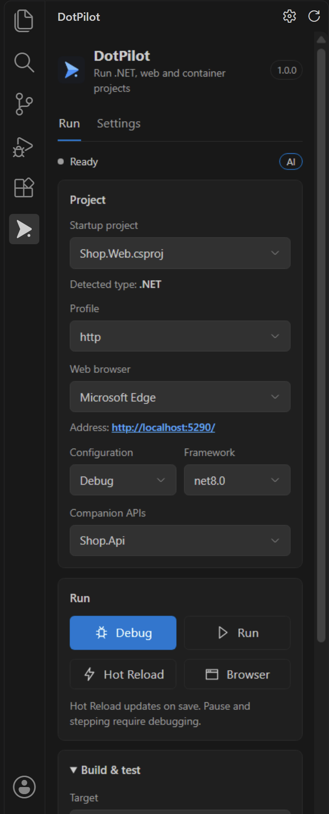
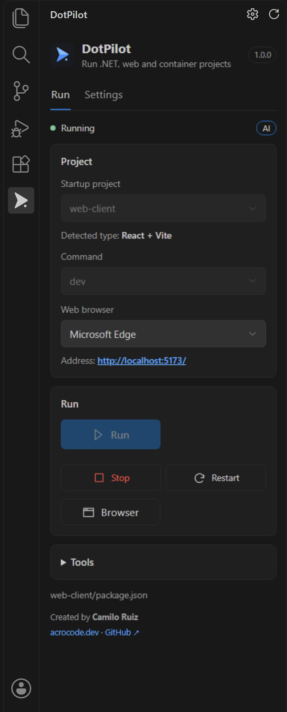
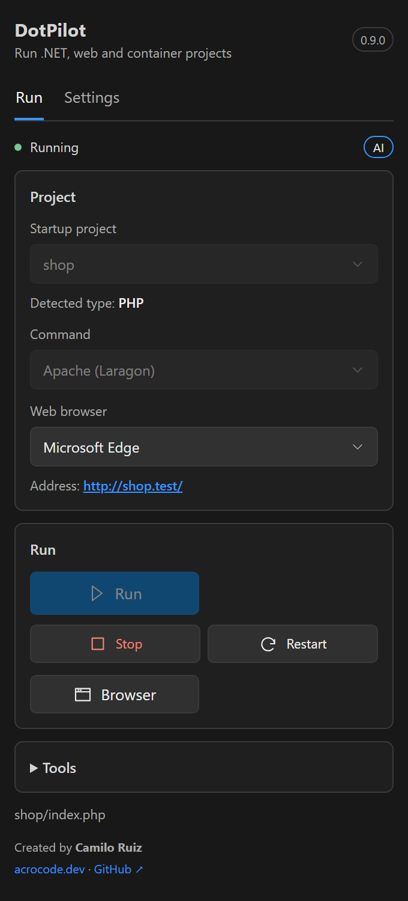
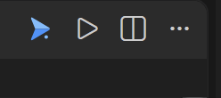
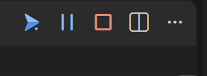
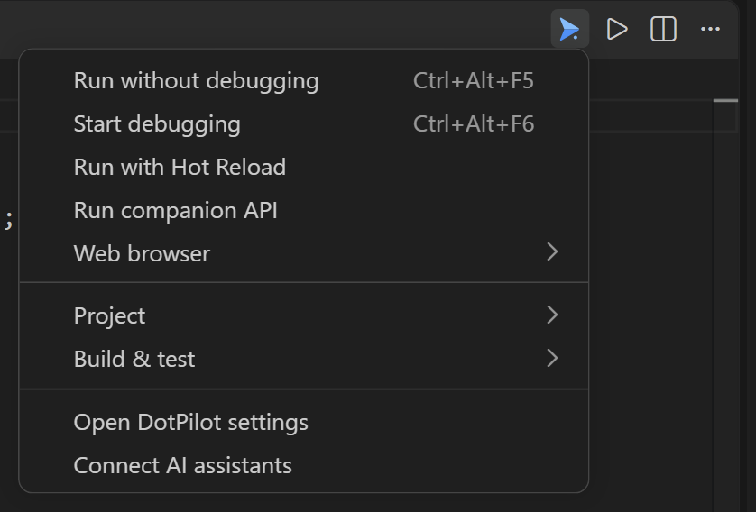

# DotPilot

**Run, debug and build .NET — and run Node.js, PHP, Python and Docker projects — from one panel in VS Code. Let your AI assistant drive them.**

DotPilot detects the runnable projects in your workspace, lets you pick a project and launch profile, and gives you Run, Stop, Restart, build and test with a linked browser that closes with your app. It also exposes the same actions to AI assistants through MCP, always with your permission.

[Español](README.es.md) · [Detailed guide](docs/GUIA.md) · [Changelog](CHANGELOG.md)

  

The editor toolbar: the DotPilot menu and Run, the same toolbar while debugging (Pause and Stop), and the menu open.

  

## What it does

- **Detects project types automatically** and shows what it found: .NET, Node.js (Vite, React, Vue, Angular, Next.js, Nuxt…), PHP/Laravel, Python (Django, FastAPI, Flask) and Docker Compose.
- **Run, Stop, Restart** for all of them, in a DotPilot terminal. Stop ends the whole process tree.
- **Reads the server URL and port from the server's own output**, so it follows the server when it moves to another port. The address is a link in the panel.
- **Linked browser:** Edge or Chrome open with a temporary profile and close the app when you close the window. Choose the browser per project; changing it while the app runs reopens it in the new one.
- **.NET extras:** debugging with the C# debugger, Hot Reload, build, rebuild, clean, restore, test and analyze, with launch profiles from `launchSettings.json`.
- **Companion APIs (.NET):** a web project can start its API (even from another solution or folder) together with it: DotPilot starts the API first, waits until it listens, then runs your project, and Stop ends both.
- **Packaging:** **Package VSIX** for VS Code extensions (uses the project's `package` script or `vsce`) and **Build APK** for Expo projects (EAS Build in the cloud or local Gradle). When it finishes you can reveal the file, install the VSIX, or open/copy the APK link.
- **Apache (Laragon) profile for PHP on Windows:** runs Laragon's own Apache with its own configuration (virtual hosts, `.htaccess`, modules) instead of `php -S`.
- **AI assistants can use it** through a local MCP server and VS Code language model tools.

## Supported projects

| Type | Detected from | Starts with |
| --- | --- | --- |
| .NET / ASP.NET Core | `.csproj`, `.sln`, `launchSettings.json` | `dotnet run`, C# debugger, `dotnet watch` |
| Node.js · React · Vue · Angular · Vite | `package.json` scripts `dev`, `start`, `serve`, `develop` | `npm`, `pnpm`, `yarn` or `bun run <script>` (from the lockfile) |
| PHP · Laravel | `artisan`, `composer.json`, `index.php` | Laragon's Apache, `php artisan serve` or `php -S` |
| Python · Django · FastAPI · Flask | `manage.py`, `requirements.txt`, `pyproject.toml` | the framework's dev server, using `.venv`/`venv`/`env` if present |
| Docker | `compose.yaml`, `docker-compose.yml` | `docker compose up` (all services or one); Stop runs `docker compose down` |

Debugging, Hot Reload, build and tests are .NET-only; they are disabled for the other types.

## Getting started

1. Open a folder with a project in a **trusted workspace**.
2. Click the **DotPilot** icon in the Activity Bar (or use the blue DotPilot menu in the editor toolbar).
3. Pick the startup project and profile, then **Run** (`Ctrl+Alt+F5`), or **Debug** (`Ctrl+Alt+F6`) for .NET.

| Shortcut | Action |
| --- | --- |
| `Ctrl+Alt+F5` | Run without debugging |
| `Ctrl+Alt+F6` | Start debugging (.NET) |
| `Ctrl+Alt+B` | Build (.NET) |

Use `Cmd` instead of `Ctrl` on macOS.

## Apache and Laragon for PHP (Windows)

`php -S` does not reproduce a real site: no virtual hosts, no `.htaccess`, no Apache modules. When a PHP project is served by **Laragon** — inside its `www` folder, or with a virtual host in `etc\apache2\sites-enabled` — DotPilot adds an **Apache (Laragon)** profile and makes it the default; `php -S` stays available.

- **Run** starts Laragon's Apache with Laragon's own `httpd.conf`, opens the site's URL (for example `http://myapp.test/`) and shows Apache's error log live, PHP errors included.
- If Apache is already running on its port, DotPilot reuses it, follows its log and **does not close it** on Stop. Otherwise Stop closes only the Apache DotPilot started.
- MySQL is **not** started. DotPilot only warns when its port does not answer: start it from Laragon.
- No administrator rights are needed and the `hosts` file is not touched. Set `dotpilot.laragonPath` for a non-standard install.
- Not covered: XAMPP/WAMP, nginx, HTTPS virtual hosts, Linux and macOS.

## AI assistants

Run **DotPilot: Connect AI assistants**. DotPilot detects the assistants installed in the editor and configures each one:

| Assistant | How it connects | Written to |
| --- | --- | --- |
| Claude Code | MCP server | `.mcp.json` in the project (do not commit it: it holds a path from your computer) |
| Codex | MCP server | `~/.codex/config.toml` |
| Gemini | MCP server | `.gemini/settings.json` in the project |
| GitHub Copilot | VS Code language model tools (agent mode) | no file |

**Verification status — please read.** Tested against the real CLIs, non-interactive, driving a Node.js and a .NET project through DotPilot:

| Assistant | Result |
| --- | --- |
| Claude Code 2.1 | Full session verified (list, select, run, read output, stop), also loading the generated `.mcp.json` |
| Codex CLI 0.149 | Full session verified; Codex also reads the generated `config.toml`. It loads the tools as deferred tools, so the model has to search for them |
| Gemini CLI 0.46 | Reads the generated `.gemini/settings.json` and connects to the server. A model session could not be tested: the account's Gemini tier is no longer supported by that CLI |
| GitHub Copilot CLI 1.0 | Reads the generated `.mcp.json` as a workspace server. A model session could not be tested: not signed in |
| Copilot in VS Code | Tool registration and invocation verified; chat confirmation is handled by VS Code and was not exercised |

Interactive sessions inside VS Code (any assistant) have not been verified.

Tools are named `dotpilot_*`: list projects, select a project or profile, run, debug (.NET), Hot Reload (.NET), stop, restart, build/test (.NET), open the browser, read the app's output and the Problems panel, and read the status with the server URL. They cannot run arbitrary commands, only the projects and profiles DotPilot detected.

**Permission and safety**

- Off until you connect an assistant, and only you can turn it on: the setting lives in your user settings, so a repository cannot enable it.
- Actions that start work (run, debug, restart, build, open browser) ask in VS Code every time: Allow / Allow for this session / Deny. Set `dotpilot.assistantsPermission` to `allow` to stop asking.
- The bridge listens only on `127.0.0.1`, requires a random token that changes on every start, and rejects requests that come from a web page.
- The MCP server needs `node` in your PATH, and the VS Code window with the folder must be open.

## Settings

| Setting | Use |
| --- | --- |
| `dotpilot.language` | `auto`, `en` or `es` for the panel and messages |
| `dotpilot.browser` | `edge`, `chrome` (linked window) or `external` (system default, not linked) |
| `dotpilot.openBrowser` | Open the browser automatically when the profile asks for it |
| `dotpilot.dotnetPath` / `pythonPath` / `phpPath` / `laragonPath` | Executables or install folder, when not on PATH |
| `dotpilot.buildScope` | Build the solution or only the startup project |
| `dotpilot.showEditorToolbar` / `showStatusBar` | Show the DotPilot menu and run buttons / status bar controls |
| `dotpilot.browserProfile` | `temporary` (default) linked window with a clean profile; `persistent` linked window whose profile is kept between runs (sign in once). Closing either stops the app |
| `dotpilot.assistantsEnabled` / `assistantsPermission` | AI assistants bridge and its permission mode (user settings only) |

Menus and the command palette follow VS Code's display language; the panel and messages follow `dotpilot.language`.

## What DotPilot does on your machine

- **No telemetry.** DotPilot itself makes no network calls. Only tools you start can use the network: your own apps, and the optional packaging commands (`npx @vscode/vsce` may download `vsce`; `eas build` talks to Expo's servers).
- **Processes:** only the projects and profiles it detected, started on your request. Stop ends them.
- **Ports:** the ones your apps use. With AI assistants enabled, one random port on `127.0.0.1` for the bridge.
- **Files:** a temporary browser profile while a linked window is open (deleted afterwards); with AI assistants enabled, `~/.dotpilot` (a copy of the MCP server and a discovery file with the bridge's token); on Windows with Laragon, a console log in the temp folder. It never edits your projects, `launch.json` or `tasks.json`. **Connect AI assistants** writes only the files listed above, after you choose them.
- **PowerShell:** the Laragon profile runs a script shipped with the extension (`assets/laragon.ps1`, readable) with `-ExecutionPolicy Bypass` for that process only. It starts or reuses Apache, tails its log and closes what it started.

## Requirements and limitations

- VS Code 1.85 or later (1.95 or later for the language model tools used by Copilot). Debugging needs Microsoft's **C# extension**; .NET SDK 8 or later.
- Needs a trusted workspace; virtual workspaces are not supported.
- **Tested on:** Windows 11 with VS Code 1.141 and 1.85.2 (the declared minimum), .NET SDK 10 (net8.0 target), Node.js 24, PHP 8.3, Python 3.14. On 1.85 the language model tools do not exist (Copilot integration needs 1.95) and C# debugging was not exercised. **Not tested:** Linux, macOS, WSL, SSH and dev containers. CI runs the unit tests on Windows, Linux and macOS.
- Only .NET `Project` launch profiles are supported (no IIS Express or Docker profiles).
- Run output of a **debug** session goes to VS Code's Debug Console and is not available to assistants.

## Troubleshooting

- *The project does not appear:* it needs a `.csproj`, a `package.json` with a `dev`/`start`/`serve`/`develop` script, `artisan`/`composer.json`/`index.php`, `manage.py`/`requirements.txt`/`pyproject.toml` or a Compose file. Use **Refresh**.
- *The browser does not open:* check `dotpilot.openBrowser` and that the profile requests it; HTTPS needs a valid development certificate.
- *Output channel:* **DotPilot: Show output** has the extension's own diagnostics.

## License

MIT © Camilo Ruiz · [acrocode.dev](https://acrocode.dev) · [GitHub](https://github.com/camiloruizx)
